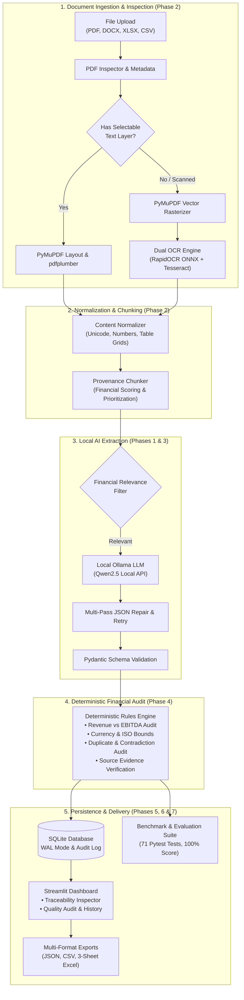

# Financial Document Intelligence

**Local AI-Powered Financial Information Extraction System**

Financial Document Intelligence extracts structured financial metrics and company metadata from annual reports, financial statements, spreadsheets, and press releases using Python document-processing tools combined with a **100% locally running LLM via Ollama** (`qwen2.5` by default).

> **Privacy-First Architecture:** Financial documents never leave your machine. External Ollama hosts are blocked by default.

---

## Project Architecture

```text
financial-document-intelligence/
├── app.py                  # Streamlit application entry point
├── config.py               # Environment settings, directory setup, logging
├── requirements.txt        # Python dependencies
├── .env.example            # Sample local configuration
│
├── core/                   # Document loading, PDF inspection, text/table extraction, OCR, chunking
├── llm/                    # Local Ollama client, structured prompts, extraction orchestrator
├── schemas/                # Pydantic output models
├── validation/             # Schema repair and deterministic financial rules
├── database/               # SQLite persistence and repository
├── ui/                     # Streamlit dashboard pages
├── exports/                # JSON, CSV, and Excel export utilities
├── tests/                  # Pytest test suite & synthetic ground-truth fixtures
├── reports/                # Benchmark evaluation JSON reports
├── data/                   # Local SQLite database
├── uploads/                # Uploaded source documents
└── logs/                   # Rotating application logs
```

---

## Project Architecture Overview (Phases 1–7 Complete)



### Implementation Milestones (Phases 1–7)

| Phase | Milestone | Key Deliverables & Modules | Status |
| :--- | :--- | :--- | :---: |
| **Phase 1** | **Project Architecture & Local LLM Enforcement** | Modular layout, strict localhost Ollama endpoint validation, Pydantic settings, rotating logging | ✅ **Complete** |
| **Phase 2** | **Document Ingestion & Dual-Engine OCR** | PyMuPDF layout parsing, `pdfplumber` tables, RapidOCR ONNX fallback, multi-sheet prioritization | ✅ **Complete** |
| **Phase 3** | **Local LLM Structured Extraction** | Local Ollama REST client, model resolution, provenance chunking, multi-pass JSON repair | ✅ **Complete** |
| **Phase 4** | **Pydantic Validation & Financial Rules** | Revenue vs EBITDA validation, currency checks, duplicate/contradiction detection, source verification | ✅ **Complete** |
| **Phase 5** | **Streamlit Dashboard & Formatted Exporters** | KPI cards, Plotly charts, Source Traceability Inspector, 1-click JSON, CSV, and 3-sheet Excel exports | ✅ **Complete** |
| **Phase 6** | **SQLite Document History & Audit Trail** | Thread-safe WAL SQLite database, cascade deletion, search filters, audit logging | ✅ **Complete** |
| **Phase 7** | **Quality Assurance, Pytest Suite & Benchmark** | 71 automated pytest unit & E2E tests (100% pass), benchmark evaluation runner (`reports/benchmark_report.json`) | ✅ **Complete** |

---

## Installation & Setup Guide

Follow this step-by-step guide to install, configure, and launch the complete system on Windows, macOS, or Linux.

### 1. Prerequisites Checklist

Ensure your system meets the following prerequisites before proceeding:
- **Python 3.11+** (Python 3.11 or 3.12 recommended; check with `python --version` or `py -V`).
- **Git** (check with `git --version`).
- **Ollama** installed locally (required for 100% private, on-device LLM inference; [ollama.com/download](https://ollama.com/download)).
- **Zero-Dependency OCR Ready:** The system includes **RapidOCR ONNX Runtime**, which runs in-process directly from Python wheels. **No external C++ binaries, Windows installers, or administrator permissions are required** for OCR!

---

### 2. Step-by-Step Installation

#### Step 1: Navigate to the Project Directory
```bash
cd financial-document-intelligence
```

#### Step 2: Create & Activate Virtual Environment

##### Windows (PowerShell)
```powershell
# Create virtual environment
py -3.12 -m venv .venv

# If PowerShell blocks script execution, run:
Set-ExecutionPolicy -Scope Process -ExecutionPolicy Bypass

# Activate virtual environment
.\.venv\Scripts\Activate.ps1
```

##### Windows (Command Prompt / CMD)
```cmd
py -3.12 -m venv .venv
.\.venv\Scripts\activate.bat
```

##### Linux / macOS (Bash / Zsh)
```bash
python3 -m venv .venv
source .venv/bin/activate
```

*(Your terminal prompt should now display `(.venv)`).*

#### Step 3: Upgrade Pip & Install Python Dependencies
```bash
python -m pip install --upgrade pip
pip install -r requirements.txt
```

> **Note on OCR & Dependencies:**  
> The requirement `rapidocr-onnxruntime>=1.4.0` automatically installs pre-compiled ONNX models and runtime engines. Scanned PDFs are rasterized in-memory via PyMuPDF vector renderer without needing external Poppler utilities or Tesseract installers.

#### Step 4: Configure Local Environment (`.env`)

Copy the provided environment template to `.env`:

##### Windows (PowerShell)
```powershell
Copy-Item .env.example .env
```

##### Windows (CMD)
```cmd
copy .env.example .env
```

##### Linux / macOS
```bash
cp .env.example .env
```

The default values in `.env` are pre-tuned for local inference:
| Setting | Default Value | Description |
| :--- | :--- | :--- |
| `OLLAMA_BASE_URL` | `http://localhost:11434` | Strict local-only Ollama REST endpoint (external hosts are blocked). |
| `OLLAMA_MODEL` | `qwen2.5:latest` | Default local LLM for financial extraction. |
| `OLLAMA_TEMPERATURE` | `0.0` | Deterministic greedy decoding for factual extraction. |
| `OLLAMA_NUM_CTX` | `8192` | LLM context window size. |
| `CHUNK_SIZE` | `3500` | Target characters per document chunk. |
| `MAX_CHUNKS_PER_DOCUMENT` | `50` | Maximum chunks per document (prioritized by financial keywords). |
| `OCR_ENABLED` | `true` | Enables automatic fallback OCR on scanned pages. |
| `DATABASE_PATH` | `data/financial_intel.db` | Local SQLite database location. |

---

### 3. Local LLM Setup (Ollama)

Financial documents must never leave your machine. The extraction engine connects exclusively to your locally hosted Ollama service.

1. **Install Ollama:**
   - **Windows:** Download and run the official installer from [ollama.com/download/windows](https://ollama.com/download/windows).
   - **macOS:** Download the macOS app from [ollama.com/download/mac](https://ollama.com/download/mac).
   - **Linux:**
     ```bash
     curl -fsSL https://ollama.com/install.sh | sh
     ```

2. **Start the Ollama Server:**  
   *(If not already running in your system tray or background service)*:
   ```bash
   ollama serve
   ```

3. **Pull the Default Model (`qwen2.5`):**
   ```bash
   ollama pull qwen2.5
   ```
   *(Optional alternatives supported: `ollama pull qwen2.5:7b`, `ollama pull qwen2.5:14b`, `ollama pull llama3.1`)*.

4. **Verify Ollama Connection:**  
   Run the built-in diagnostic health check:
   ```bash
   python -m llm.ollama_client
   ```
   *Expected output: `✓ Ollama server reachable at http://localhost:11434 | Found installed models: ['qwen2.5:latest']`.*

---

### 4. Optional System OCR Binaries (Advanced)

While `rapidocr-onnxruntime` is the primary zero-dependency OCR engine, the system also supports system-installed Tesseract if available:
- **Windows:** Install [UB-Mannheim Tesseract OCR](https://github.com/UB-Mannheim/tesseract/wiki) to `C:\Program Files\Tesseract-OCR` or specify `TESSERACT_CMD` in `.env`.
- **Ubuntu/Debian:**
  ```bash
  sudo apt-get update && sudo apt-get install -y tesseract-ocr poppler-utils
  ```

---

### 5. Verification & Quick Start

#### Step 1: Run Full Automated Test Suite (71 Tests)
Verify that all document loaders, schema models, deterministic validation rules, and SQLite repositories operate cleanly:
```bash
pytest -v
```
*(All 71 tests should pass in ~15–20 seconds).*

#### Step 2: Run Dataset Benchmark Runner
Benchmark extraction against synthetic annual reports, preliminary press releases, scanned statements, and 300-sheet workbooks:
```bash
python evaluate_dataset.py
```
*(Confirms 27/27 assertions pass with 100.0% score and saves `reports/benchmark_report.json`).*

#### Step 3: Launch the Streamlit Web Application
Start the interactive dashboard:
```bash
streamlit run app.py
```
The browser will automatically open to `http://localhost:8501`.

---

## Document Ingestion & Extraction Pipeline (Phase 2)

```text
Upload (PDF, DOCX, XLSX, CSV)
      ↓
PDF Inspection (Metadata, selectable text check, scanned page detection)
      ↓
Extraction Engine:
  - Text Layer: PyMuPDF / pdfplumber fallback
  - Tabular Data: pdfplumber (PDF), python-docx (DOCX), openpyxl/pandas (XLSX, CSV)
  - Scanned Fallback: PyMuPDF rasterizer + pytesseract OCR
      ↓
Content Normalizer (Unicode/ligature cleaning, table integration into Markdown)
      ↓
Provenance-Preserving Chunker (Page-bounded chunks, source metadata)
      ↓
ProcessedDocument (Ready for LLM financial extraction)
```

### Supported Formats & Extraction Strategies

| Format | Text Engine | Table Engine | OCR / Fallback |
| :--- | :--- | :--- | :--- |
| **PDF** | PyMuPDF (blocks/text), `pdfplumber` fallback | `pdfplumber` (auto grid/lines) | Built-in PyMuPDF vector rasterizer + Tesseract |
| **DOCX** | `python-docx` paragraphs | `python-docx` table grids | N/A |
| **XLSX** | Worksheet cells | `pandas` / `openpyxl` sheets | N/A |
| **CSV** | Delimited records | `pandas` auto-separator detection | N/A |

---

## Local LLM Structured Extraction (Phase 3)

### Core Financial Metrics Extracted

The local Ollama LLM (`qwen2.5:latest` by default) extracts the following structured attributes:

- **Corporate Metadata:** Company Name, Country, Industry, Reporting Period, Fiscal Year, Currency
- **Financial Metrics:**
  - Revenue / Turnover
  - EBITDA (Operating earnings before interest, tax, depreciation & amortization)
  - EBIT / Operating Profit
  - Net Income / Net Profit (or Net Loss)
  - Total Assets & Total Liabilities
  - Cash Flow (Operating / Free)
  - Number of Employees (Headcount / FTEs)
  - Growth Percentage (`%` unit)

### Structured Extraction Architecture

```text
Document Chunks
      ↓
Financial Relevance Filter (Prioritizes financial narrative & tables)
      ↓
Local Ollama API (/api/generate with JSON schema format)
      ↓
Multi-Pass Controlled JSON Repair (Strips fences, fixes trailing commas, handles preambles)
      ↓
Corrective LLM Retry Prompt (If first pass unrecoverable)
      ↓
Pydantic Validation (ChunkExtractionResponse -> ExtractedMetric)
      ↓
Strict Provenance Binding (Matches exact authentic page number & document filename)
      ↓
Consensus Aggregation across chunks -> FinancialExtractionResult
```

---

## Deterministic Financial Validation & Source Traceability (Phase 4)

The system does not rely exclusively on LLM confidence scores. It enforces strict Python-level deterministic validation rules before approving metrics:

| Validation Rule | Category | Action When Triggered |
| :--- | :--- | :--- |
| **Revenue vs EBITDA Distinction** | Accounting / NLP | Flags metric if evidence keywords contradict metric label, or if reported EBITDA > Revenue for the same period. |
| **Financial Year Sanity** | Domain Integrity | Enforces 1980–2040 operational bounds; flags wide divergence (> 4 years) from document primary year. |
| **Currency Consistency** | Foreign Exchange | Validates against ISO 4217 currency standards and flags discrepancies against document primary currency. |
| **Percentage vs Absolute Amounts** | Scale / Unit | Rejects `%` on absolute monetary values (e.g. Revenue `%`); requires `%` on growth rates and margins. |
| **Null Value Preservation** | Audit Trail | Guarantees missing items remain `null` rather than hallucinated or defaulted to 0; marks for manual review. |
| **Duplicate Metric Detection** | Consolidation | Identifies identical metric values appearing across multiple pages. |
| **Contradictory Values Detection** | Multi-Page Audit | Flags conflicting numbers extracted for the same metric and year from different pages. |
| **Suspicious Unit Scaling** | Unit Conversion | Detects unscaled values (e.g. 12.5) when source evidence explicitly specifies "million" or "thousand". |
| **Source Evidence Traceability** | Provenance | Cross-checks cited verbatim evidence against the actual text of the cited page; rejects fabricated page citations. |

---

## Modern Streamlit Dashboard & Formatted Exports (Phase 5)

The application provides an enterprise-style Streamlit UI organized into dedicated functional views:

1. **📊 Executive Dashboard (`ui/dashboard.py`)**:
   - Live KPI cards: Total Documents Ingested, Extracted Metrics, Verified Count, Review Required.
   - Interactive Plotly visualizations: Donut chart of validation quality distribution & bar chart of document formats.
   - Ingestion history table showing recent corporate filings and validation metrics.

2. **📤 Document Ingestion & Extraction (`ui/upload.py`)**:
   - Drag-and-drop file uploader supporting `.pdf`, `.docx`, `.xlsx`, `.csv`.
   - Dynamic local Ollama model selector with installed tag resolution.
   - Real-time step-by-step progress tracker with chunk execution logs.
   - Automatic execution of inspection → local extraction → deterministic validation → SQLite persistence.

3. **📋 Financial Extraction Results (`ui/results.py`)**:
   - **Company Summary Card**: Highlights corporate entity, fiscal year, reporting period, currency, and sector.
   - **Structured Metrics Tab**: Searchable, status-filterable table displaying metrics with formatted numbers, units, and verification status.
   - **Source Traceability Inspector**: Interactive drill-down linking any metric to its exact page citation, verbatim quote, and full page text layer.
   - **Validation & Quality Audit**: Tabular breakdown of triggered accounting rules, detected duplicates, and cross-page contradictions.
   - **JSON Viewer & Exports**: Syntax-highlighted JSON viewer with one-click downloads for JSON, CSV, and formatted 3-sheet Excel workbooks (`.xlsx`).

4. **🗄️ Document Archive & History (`ui/history.py`)**:
   - Access historical extractions stored in SQLite.
   - Single-click loading of any prior document into the active session viewer.
   - Record deletion with cascading removal of metric rows.

5. **⚙️ System Settings & Diagnostics (`ui/settings.py`)**:
   - Live Ollama ping and model catalog checker.
   - Configurable chunk size, overlap, temperature, and context length (`num_ctx`).
   - OCR engine configuration (toggle, DPI slider, language, custom Tesseract binary path).

---

---

## SQLite Document History & Audit Trail (Phase 6)

Extracted intelligence is automatically persisted locally in SQLite (`data/financial_intel.db`) using thread-safe WAL mode:

- **`documents` Table:** Stores document metadata, file hashes, page count, resolved company attributes, raw inspection JSON, extraction output JSON, and validation audit JSON.
- **`metrics` Table:** Stores each individual metric linked via foreign key with ON DELETE CASCADE, preserving numeric value, units, year, reporting period, verbatim evidence text, page number, verification status, and rule failure descriptions.
- **`DocumentRepository`:** Provides query methods for dashboard KPI aggregation, historical record retrieval, and document deletion.
- **Rotating Application Logging:** Formatted logging to `logs/financial_intel.log` with rotating 5 MB backups and console output.

---

## Test Dataset Evaluation & Benchmark (Phase 7)

The project includes an end-to-end evaluation test suite and benchmark runner against synthetic and real-world corporate financial documents in `financial_document_test_dataset/`:

1. **`01_northstar_annual_report_2025.pdf`**: Multi-page report containing narrative and consolidated highlights table. Evaluates exact numeric match rate, and verifies that average employees (81) is distinguished from year-end employees (84).
2. **`02_northstar_press_release_2025.pdf`**: Press release with preliminary unaudited figures (EUR 12.3M revenue vs EUR 12.5M audited). Verifies that preliminary status is preserved without conflicting values being merged.
3. **`03_alpine_works_scanned_statement.pdf`**: Scanned image-only PDF evaluating scanned page detection and dual-engine OCR fallback (in-process ONNX RapidOCR + system Tesseract).
4. **`entire-omv-ar25.xlsx`**: Comprehensive 300-sheet corporate filing testing multi-sheet extraction and financial statement chunk prioritization.
5. **`ground_truth.json`**: Reference ground truth for automated evaluation.

### Running the Evaluation Benchmark
```bash
python evaluate_dataset.py
```
Outputs a real-time terminal audit and writes structured results to `reports/benchmark_report.json`:
- **Detection Accuracy:** 100% on selectable text layers and scanned pages
- **Metric Verification:** 27/27 assertions passed (100.0%) across all test documents
- **Ingestion & Prioritization:** 300-sheet Excel workbook prioritized into 50 financial chunks

### Running the Complete 71-Test Automated Test Suite
```bash
pytest -v
```
Test modules covered:
- `tests/test_dataset_evaluation.py`: Inspection and ground-truth alignment across all benchmark files (7 tests)
- `tests/test_pipeline_e2e.py`: Full lifecycle integration, error handling, vacuuming (4 tests)
- `tests/test_exports_and_db.py`: Multi-format exports (JSON, CSV, multi-sheet Excel), repository CRUD, audit logs (6 tests)
- `tests/test_extraction.py`: Text layer detection, OCR fallback, normalizer, chunker (14 tests)
- `tests/test_financial_extractor.py`: JSON repair, chunk relevance, LLM retry prompt, offline handling (10 tests)
- `tests/test_ollama_client.py`: Local Ollama enforcement, endpoint discovery, timeout handling (11 tests)
- `tests/test_schemas.py`: Pydantic models, boundary validation, negative value preservation (6 tests)
- `tests/test_validation.py`: Deterministic financial rules, Revenue vs EBITDA, duplicate and contradiction audit (13 tests)

---

## Running the Application

Launch the Streamlit web dashboard:
```bash
streamlit run app.py
```

Diagnostic CLI check for local Ollama server:
```bash
python -m llm.ollama_client
```
